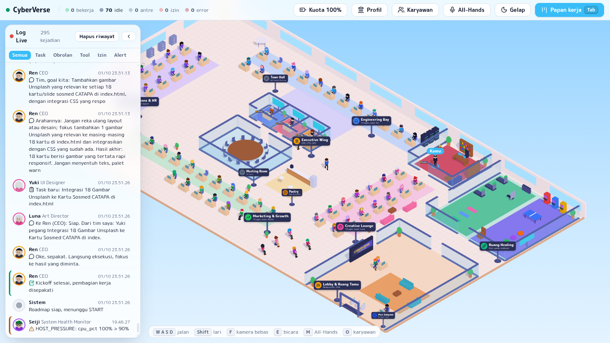
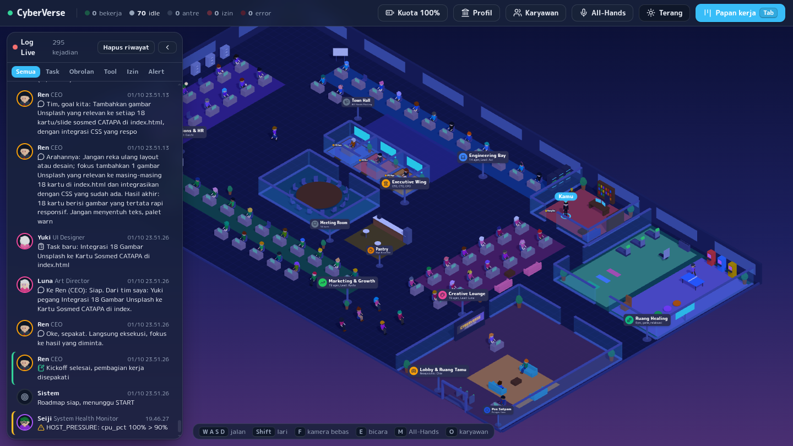
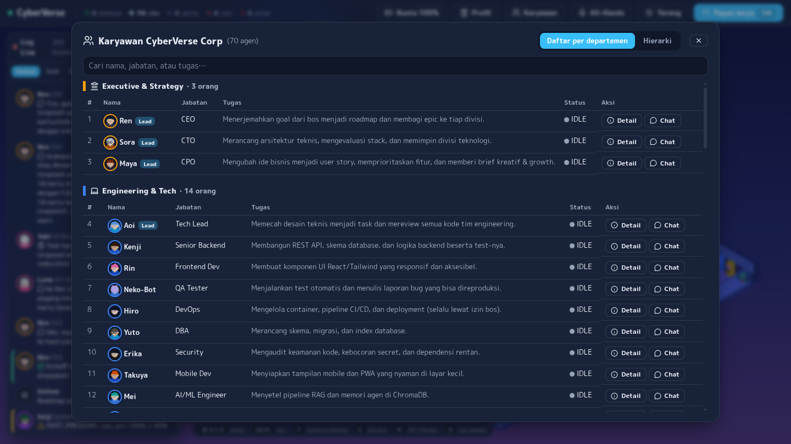

# CyberVerse Corp: 3D Anime AI Office

Spesifikasi lengkap: [docs/PRD-v3.md](docs/PRD-v3.md). Status: **Fase F3 (50 agen, operasional, All-Hands)**: PRD §24.

## Tangkapan layar



| Mode gelap | Direktori karyawan |
| --- | --- |
|  |  |

## Pembaruan visual & kantor

- **Avatar 3D humanoid** ber-skeleton (duduk, mengetik, berpikir, jalan, bicara, bersorak), 50 tampilan unik sesuai persona PRD, bebas lisensi (prosedural).
- **Kantor 80×44 m:** Executive Wing (kantor pribadi CEO/CTO/CPO), Ruang Bos milikmu, meeting room 14 kursi, Ruang Healing (gym + game), Lobby & ruang tamu dengan resepsionis dan pos satpam, pantry, rak server, lemari arsip, tanaman.
- **Papan penunjuk** departemen + plakat pintu; **balon chat** dengan garis penunjuk ke avatar yang bicara.
- **Direktori karyawan** (`O` / 👥): daftar per departemen (jabatan, tugas, status) + bagan hierarki.
- **Bahasa agen** menyesuaikan situasi: baku untuk dokumen, semi-formal ke atasan, santai antar-rekan, mengikuti gaya bos di chat.

## Isi F3

- **Agen system-backed** (`backend/app/ops.py`, tanpa LLM):
  - Masa: kuota tiap 10 dtk, alert < 20%, paralelisme turun ke 3.
  - Seiji: CPU/RAM/disk/Ollama tiap 30 dtk, deteksi task macet > 15 menit.
  - Zero: pembersihan log/pesan lama, selalu lewat approval `Cache_Cleaner`.
- **Penutupan goal:** Hanako menulis `INDEX.md`, Shiori menyusun `REPORT-<goal>.md` beserta ringkasan eksekutif (tombol 📄 Laporan di Kanban).
- **All-Hands Meeting** (`M` / tombol 🎤): agen idle berkumpul di Town Hall (50 slot), Ren membuka, 6 lead memberi update dari data nyata, Nana menulis notulen (disimpan ke memori). Agen yang sibuk ikut "remote" 📡.
- **Verifikasi anti-halusinasi:** laporan yang menyebut file yang tidak ada di workspace otomatis dikembalikan (BLOCKER); reviewer menerima daftar file aktual.
- **UI:**
  - label departemen di lantai (nama, jumlah agen, lead);
  - widget 🔋 kuota + kesehatan server;
  - notifikasi alert;
  - kamera terbang ke agen saat diklik;
  - LOD saat zoom out;
  - agen idle jalan ke pantry & celetukan (0 token).

## Isi F2

- **Review loop** (PRD §13.4): engineering direview Aoi (Sora bila Aoi pelaksananya), divisi lain oleh lead-nya; maks 5 iterasi lalu **mediasi Kazu** (terima / terima + task lanjutan / eskalasi ke manusia).
- **Gate test deterministik**: sebelum review engineering, sistem menjalankan pytest sungguhan di sandbox; test merah langsung dikembalikan tanpa memanggil LLM, hasil hijau diberikan ke reviewer.
- **Memori** (PRD Bab 14): ChromaDB embedded + embedding lokal `all-MiniLM-L6-v2`; Eri mengindeks hasil task, roadmap disimpan sebagai DECISION, top-3 disisipkan ke prompt. **Aturan Supervisor** via `POST /api/v1/rules`.
- **Chat langsung** dengan agen (panel chat, riwayat per agen, "Jadikan task"), konteks: aktivitas terbaru tim dari DB + memori + aturan.
- **Mode CEO**: avatar "Kamu": `W A S D` (relatif kamera), `Shift` lari, klik lantai (A*), `E` bicara saat ≤ 2 m dari meja agen, `F` kamera follow.
- Avatar chibi prosedural (kepala, rambut, badan): pengganti sementara model GLB anime (butuh aset VRoid/Mixamo).

Catatan: model embedding (~90 MB) diunduh otomatis saat pertama jalan; bila unduhan S3 Chroma lambat, taruh file dari
`huggingface.co/sentence-transformers/all-MiniLM-L6-v2` (`config.json`, `special_tokens_map.json`, `tokenizer_config.json`,
`tokenizer.json`, `vocab.txt`, `onnx/model.onnx`) ke `~/.cache/chroma/onnx_models/all-MiniLM-L6-v2/onnx/`.

## Isi F1

- Orkestrator LLM (`backend/app/llm_orchestrator.py`): Ren (CEO) → Roadmap JSON → lead divisi memecah epic → Delegation_Router (skill) → agen mengeksekusi via CrewAI dengan failover model (Groq → Gemini → Mistral → OpenRouter).
- Tool bergerbang (`backend/app/tools.py`): File_Write/Read/List, Python_Runner, PyTest_Runner (sandbox Docker tanpa internet), Terminal_Execute (HIGH, wajib approval, sandbox dengan internet).
- 50 profil agen di `backend/config/agents.yaml` (dihasilkan dari PRD Bab 8-12). Output tiap task: `workspace/<goal_id>/reports/`.
- UI: tema terang (default) / gelap, 10 kartu template perintah dengan field konteks, status pill, marker error.

## Isi F0

- Backend FastAPI satu proses: WebSocket (`seq`, resume, resync, coalescing), SQLite WAL (skema + seed 50 agen/50 meja), Approval Gate + classifier risiko, LLM Router (kuota & failover, belum dipanggil).
- Scheduler task (dependensi, maks agen aktif). **DEMO_MODE=1**: eksekusi task & roadmap disimulasikan (`backend/app/sim.py`): tanpa LLM/API key.
- Frontend React Three Fiber: kantor isometrik 60×40 m, 50 avatar kapsul toon + outline, ikon emosi, balon komik, pathfinding A*, Kanban (`Tab`), modal approval, panel agen (klik avatar).

## Menjalankan (lokal)

Cara cepat: backend + frontend sekaligus, `Ctrl+C` menghentikan semuanya:

```bash
./dev.sh          # mode LLM sungguhan (memakai kuota free tier)
./dev.sh --demo   # simulasi tanpa LLM
```

Port bisa diganti: `BE_PORT=8020 FE_PORT=5180 ./dev.sh`. Cara manual:

```bash
# backend (Python 3.11+)
cd backend
python3 -m venv .venv && .venv/bin/pip install -r requirements.txt
.venv/bin/uvicorn app.main:app --port 8010

# frontend (Node 20+)
cd frontend
npm install && cp .env.example .env
npm run dev          # http://localhost:5173, token default: dev-token
```

Sandbox (sekali): `docker build -t cyberverse-sandbox:0.1 sandbox`

Env backend (`backend/.env`): `GROQ_API_KEY`, `GEMINI_API_KEY`, `MISTRAL_API_KEY`, `OPENROUTER_API_KEY` (provider tanpa key dilewati), `OLLAMA_HOST` (opsional), `SUPERVISOR_TOKEN` (default `dev-token`), `DATABASE_PATH`, `WORKSPACE_PATH`, `FRONTEND_ORIGIN`, `DEMO_MODE=1` (simulasi tanpa LLM), `MAX_ACTIVE_AGENTS`.

## Test

```bash
cd backend && .venv/bin/python -m pytest -q     # gate, router, alur goal+approval, WebSocket
cd frontend && npx vitest run && npx tsc --noEmit
```

## Berikutnya (F4: Hardening)

Deploy Oracle Cloud (Docker Compose + Caddy), backup harian, skenario uji §22.2 yang tersisa (beban WS 100 event/dtk, FPS di GPU nyata), security review, dan avatar GLB anime bila aset tersedia.

## Pembaruan alur kerja (2026-09-30)

- **Kickoff dulu, baru eksekusi**: Ren dan lead terkait rapat singkat di Meeting Room. Arahan Ren dan pembagian kerja dicatat sebagai notulen dan ikut masuk ke setiap task.
- **Pengerjaan ringkas**: maksimal 3 epic x 3 task, tanpa task seremonial (review, diagram, dokumentasi) kecuali diminta. Revisi maksimal 2 kali, lalu diputus Kazu.
- **Laporan hasil ke bos**: saat goal selesai, modal Laporan Hasil terbuka otomatis (ringkasan, durasi, siapa mengerjakan apa, file hasil dengan pratinjau). Bisa dibuka lagi dari Kanban.
- **Rekrutmen oleh HRD (Sena)**: lead bisa meminta keahlian baru. Kebijakannya di `backend/app/hr.py`: pinjam bila keahlian sudah ada, tolak bila kuota (10) atau meja habis, tanya bos bila ragu, rekrut langsung bila jelas.
- **Log Live** tersimpan di database (`event_log`) dan dimuat ulang saat halaman dibuka.
- Markdown (notulen, laporan, dokumen agen) dirender, bukan ditampilkan mentah.
- **Sembilan karyawan tetap baru (51-59)**: HR Manager/HRD (Sena), Finance (Tetsu), Legal (Ayame), Data Analyst (Jiro), Web Developer (Momo), Graphic Designer (Kei), Content Writer (Hotaru), Business Development (Ryo), Customer Support (Sumire).
- **Tim Konten & Media Sosial (60-70)**: Head of Content & Social Media (Kanade) membawahi Virality & FYP (Hayate), Content Strategist (Shizuka), Content Planner (Mitsuki), Repurposing (Ibuki), Social Media Analyst (Satoru) di Marketing; Hook (Natsu), Meme & Culture (Gaku), Editing Brief (Kyo), Localization (Sakura), Digital Asset & Rights (Misaki) di Creative. Sebelas peran lain di brief sudah ada (Tomo, Akari, Hotaru, Kaito, Hina, Taro, Yumi, Ken, Rei, Koharu, Karen) dan hanya diperluas skill serta personanya.
- **Profil perusahaan**: `backend/config/company.md` (tombol Profil di topbar, `GET /api/v1/company`). Disertakan ke konteks agen hanya bila goal/task menyebut perusahaan ini sendiri. Template goal: "Website company profile" (engineering) dan "Media sosial perusahaan" (tim konten).
- **Desain dulu, baru koding**: goal website/landing page diawali task riset + konsep desain (Yuki menulis `design.html`) yang diikuti tim koding, tanpa menunggu persetujuan bos. Desain bersifat opsional: bila gagal dibuat, task-nya dilewati dan koding tetap jalan (goal tidak ikut gagal). Riset desain memakai tool `Web_Search` (Tavily API, tier gratis) bila `TAVILY_API_KEY` diisi di `backend/.env`; tanpa key, desainer memakai pengetahuannya sendiri tanpa URL. Model yang membalas kosong dianggap gangguan model dan otomatis dicoba ke model cadangan; agen yang menulis file mendapat jatah keluaran 6000 token.
- **Lanjutkan proyek**: proyek yang selesai bisa diberi pekerjaan lanjutan (tombol Lanjutkan). Lanjutan menjadi goal baru dengan `parent_goal_id`, mulai dari salinan file versi sebelumnya, dan agen diberi riwayat permintaan serta ringkasan hasil sebelumnya. Versi lama tidak diubah, jadi bila lanjutan gagal bisa dilanjutkan lagi dari versi berhasil terakhir.
- **Hapus proyek**: `DELETE /api/v1/goals/{id}` (tombol tempat sampah di kartu, menghapus semua versi). Hanya untuk proyek yang sudah selesai dan tanpa lanjutan aktif. Folder workspace dan memori proyek dihapus; baris goal/task ditandai `deleted_at` karena log approval bersifat append-only.
- **Hapus data lain**: notulen rapat (modal notulen, juga dari memori agen), riwayat chat per agen (ikon tempat sampah di panel chat), riwayat Log Live ("Hapus riwayat"). Karyawan hasil rekrutmen HRD bisa diberhentikan dari detail karyawan bila tidak punya task terbuka: barisnya tetap untuk riwayat, mejanya dikosongkan, kuota rekrutmen kembali. Karyawan tetap (agents.yaml) tidak bisa diberhentikan.
- **Direktori karyawan**: tiap baris punya aksi Detail (profil, atasan, tim, keahlian, pekerjaan saat ini) dan Chat.
- **Rekomendasi perbaikan**: proyek gagal otomatis diberi penyebab dalam bahasa awam dan 2-3 pilihan perbaikan (Daichi, cadangan deterministik bila LLM ikut gagal; selalu ada "Sederhanakan dulu" dan "Ulangi persis"). Bos cukup menekan Pilih: perintahnya dikirim ke Ren dengan Review dulu. Proyek gagal lama: tombol "Minta rekomendasi perbaikan" (`POST /api/v1/goals/{id}/recovery`). Error teknis dilipat di "Detail teknis".
- **Lampiran perintah**: di kotak perintah untuk Ren, bos bisa melampirkan sampai 6 file referensi (gambar png/jpg/webp/gif/svg, atau teks md/txt/html/css/json/csv, maks 4 MB per file) lewat tombol klip, tempel, atau seret. File disimpan di `workspace/<goal>/references/`; gambar dideskripsikan model ber-vision (Gemini/Mistral) saat planning, lalu deskripsi dan isi file teks ikut dikirim ke Ren, lead, dan setiap pekerja. Gambar boleh dipakai langsung di HTML (`references/<nama>`).
- **Pemeriksaan visual website**: setelah `index.html` jadi, Yuki memotretnya (Chrome headless, `CHROME_BIN` bila perlu) dan model ber-vision menilai tampilannya (juga kesesuaian dengan gambar referensi bos). Skor di bawah 8/10 memberi satu putaran perbaikan dengan daftar perbaikan konkret; pemeriksaan ini tidak pernah menggagalkan task. Goal website juga mendapat standar tampilan wajib (hero terisi, skala tipografi, kontras, jarak 8px, kartu lembut, ikon SVG).
- **Meniru UI dari gambar referensi**: gambar lampiran diubah jadi blueprint detail per bagian (teks persis, warna hex, tata letak) untuk tim. Halaman dipotret penuh lewat Chrome DevTools (viewport 1280x900) dan model vision membandingkannya berdampingan dengan referensi (skor kemiripan 0-100, target 90), maks 3 putaran perbaikan memakai `File_Edit` (ubah per bagian); versi dengan skor tertinggi yang diserahkan. Foto lewat `Image_Search` (Unsplash asli via Tavily + endpoint unduhan Unsplash); URL gambar yang tidak termuat diganti otomatis oleh sistem berdasarkan alt text. Bila semua penyedia LLM putus serentak, rantai model diulang sampai 3 putaran.
- **Preview hasil**: kartu proyek yang berhasil menampilkan screenshot bagian atas hasil terakhir (`GET /api/v1/goals/{id}/preview`, disimpan di `reports/preview.jpg`, dibuat otomatis saat goal selesai atau saat pertama dibuka).
- **Standar totalitas**: aturan global meminta hasil setara portofolio terbaik (isi kaya dan spesifik, tanpa placeholder) plus periksa-ulang mandiri; tiap task membawa standar mutu divisinya (`CRAFT`); reviewer menolak hasil yang asal jadi; batas panjang jawaban dinaikkan.
- **Laporan hasil**: blok hasil utama dengan tombol buka website di tab baru (tetap di iframe sandbox), SVG tampil sebagai gambar. Arsip proyek: percobaan ulang dengan perintah yang sama menjadi satu kartu, percobaan lama masuk "Riwayat".
